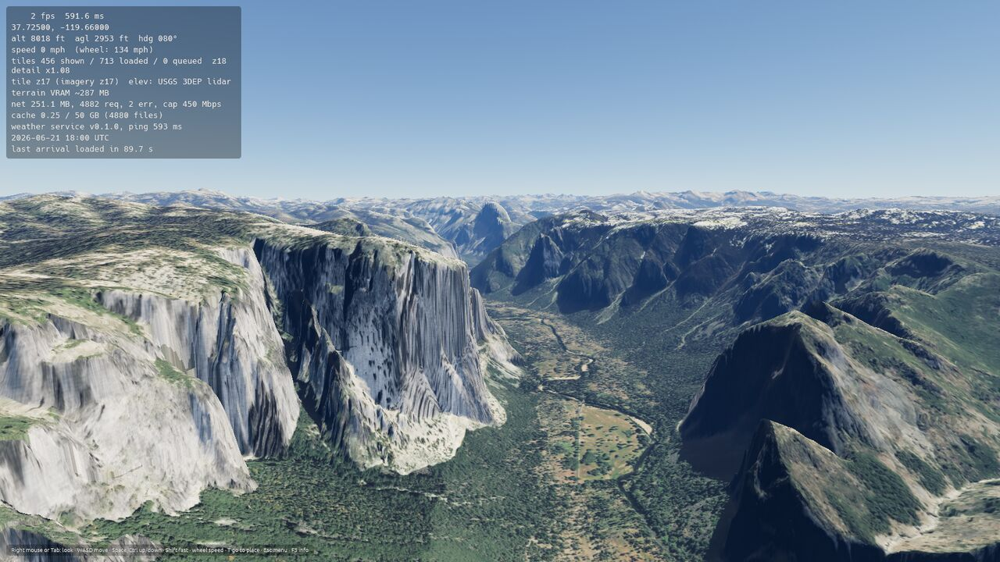
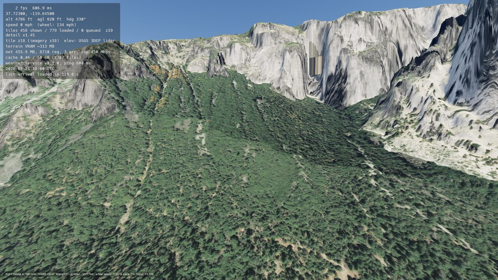
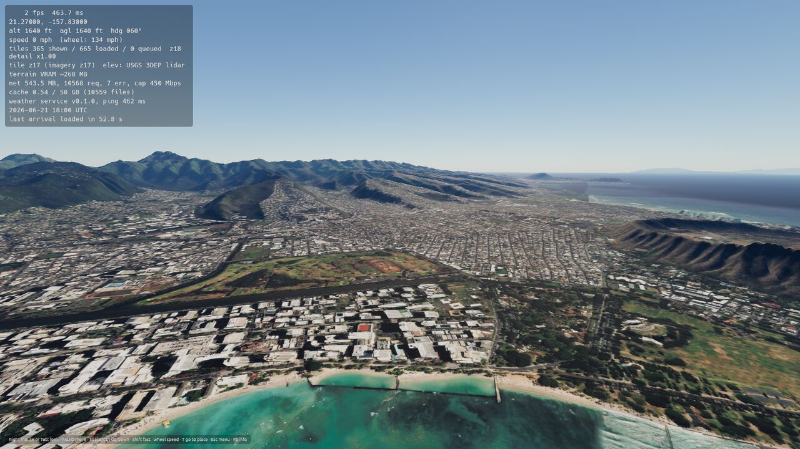
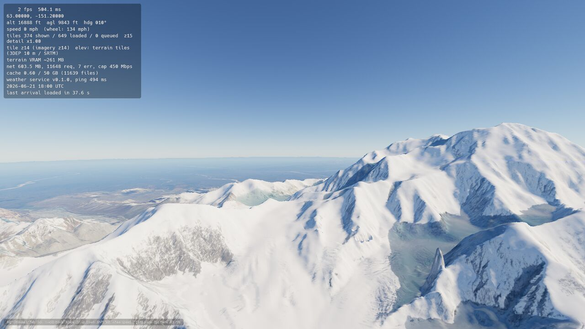
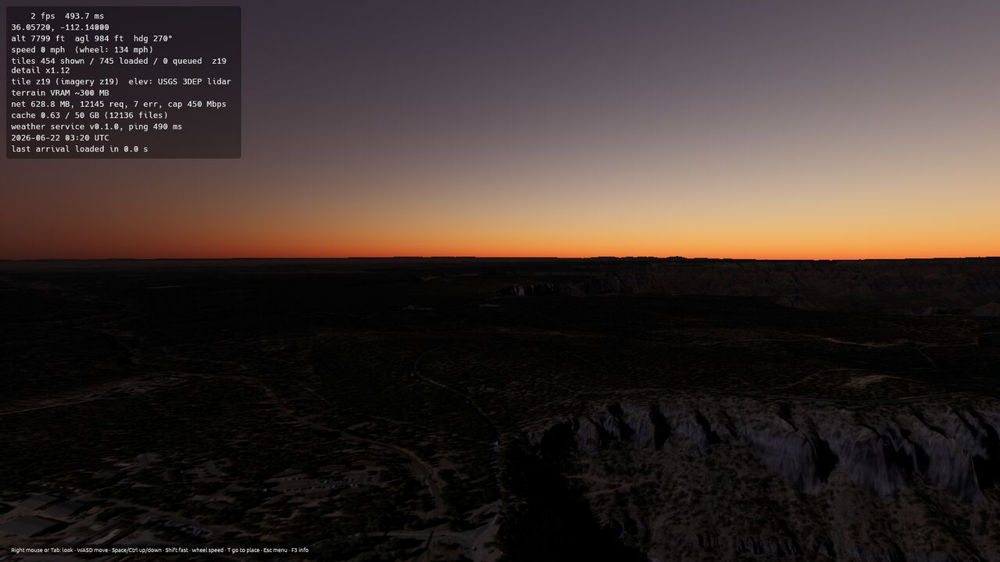
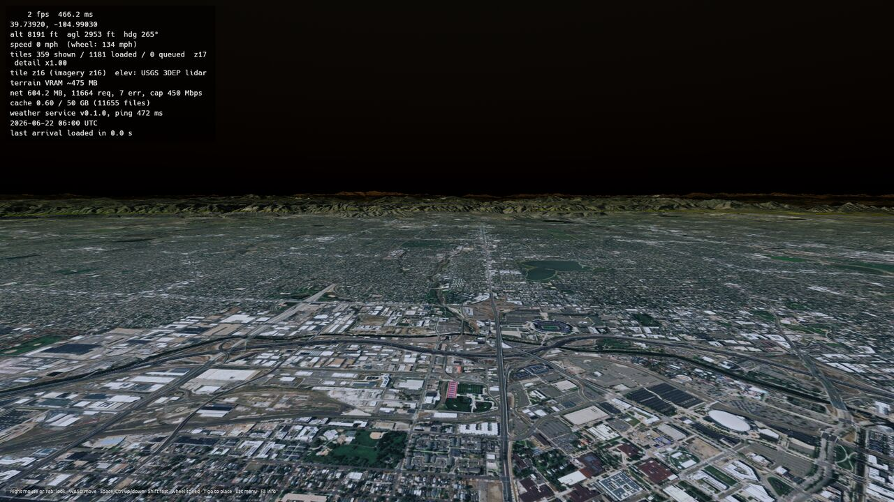
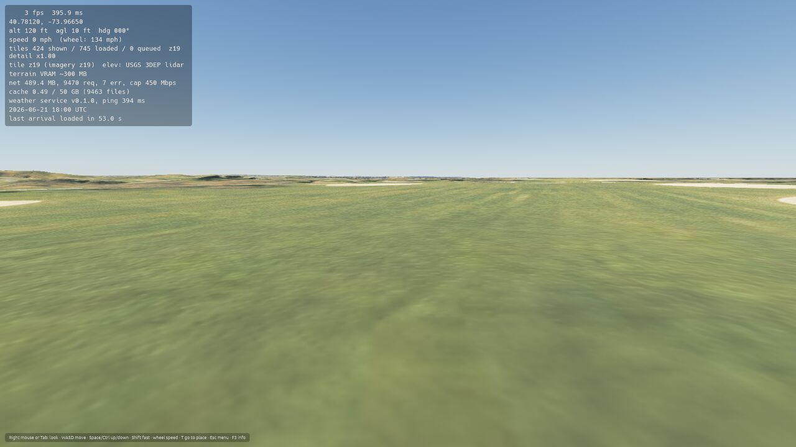
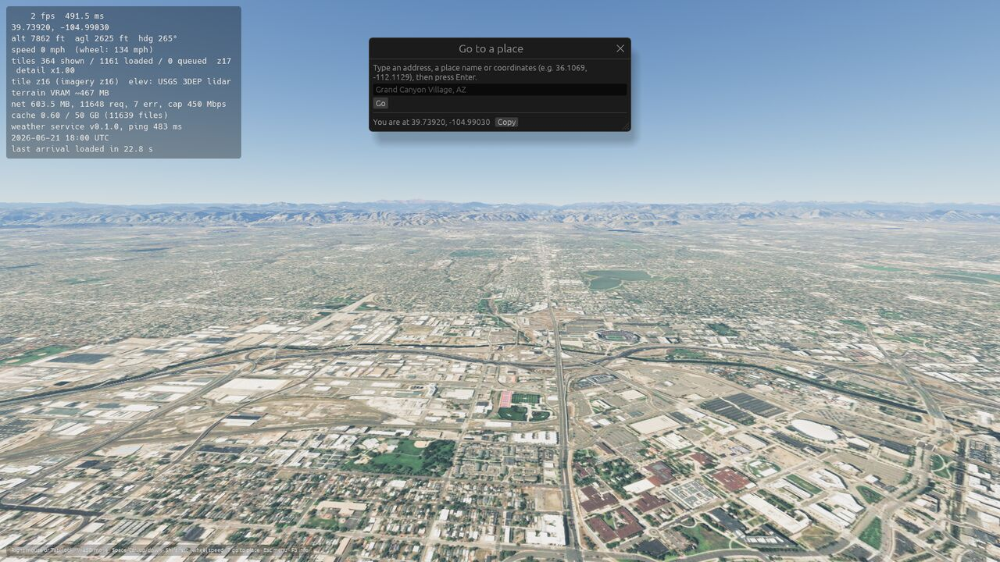

# Progress: Phase 1 (Terrain, imagery and streaming), v0.1.0

**Status:** complete · released as v0.1.0 on 2026-10-20 · previous phase: [Phase 0](progress/progress_phase_0.md) (released [v0.0.0](https://github.com/goglesquirmintontheiii/us-explorer/releases/tag/v0.0.0))

Goal: real ground shape and real imagery everywhere in the US, loading gracefully on slow hardware or connections.

Open GitHub issues checked at the start of this phase: none.

## Tasks

- [x] Elevation tiles: USGS 3DEP lidar (1 m class) from zoom 16 up, 10 m terrain tiles below, sea level fallback offline
- [x] Full coverage: lower 48, Alaska, Hawaii and Puerto Rico (Web Mercator quadtree)
- [x] Rock on steep slopes so cliffs don't show stretched imagery
- [x] Esri World Imagery with a USGS/NAIP switch in Settings
- [x] Level of detail by on-screen texel size, full detail around you, coarse to the horizon
- [x] Skirts on every tile edge to hide cracks between zoom levels
- [x] Ground detail near the camera (grass, asphalt, dirt, rock) with small bumps
- [x] Collision matches the drawn triangles exactly
- [x] Lazy loading: nearest tiles first, parents stay until children are ready, never blocks a frame
- [x] Adaptive streaming: detail backs off when downloads or frames fall behind
- [x] Prefetch along the direction of travel; optional slow-down while loading
- [x] Loading indicator
- [x] Arrival timing in the overlay; visited areas load from the disk cache with no network
- [x] Shadows baked into imagery lifted slightly
- [x] Offline area download (Esc → Offline download)
- [x] BC1-compressed imagery textures (about 8x less video memory) when the GPU supports it
- [x] Teleport holds you above the ground until detailed terrain arrives
- [x] Fix: finished tiles waiting to be uploaded now count as loading (screenshots were taken too early)
- [x] Fix (reported in v0.0.0): black screen at night; exposure now adapts to the sun
- [x] Fix (reported in v0.0.0): Enter in the place search did nothing
- [x] Fix: cracks on cliffs between tiles of different detail
- [x] Fix: updates through GitHub redirects; system certificate store
- [x] Verify street-level, canyon and night views in fresh screenshots
- [x] Release v0.1.0

Deferred on purpose:
- Real lake and coastal depths are already in the data but stay hidden until water exists (Phase 5); today the ground is clamped at sea level.
- Snow on high peaks follows the season and weather, so it belongs to Phase 7.

## Screenshots

Rendered by CI on a software renderer (about 2 fps), so frame rates and arrival times in the overlay aren't representative.

**Yosemite Valley.** Lidar elevation; cliff cracks between detail levels are fixed.

**250 m from El Capitan's base:** full zoom-19 detail right up to the cliff

**Waikiki and Diamond Head, Hawaii**

**Denali, Alaska**

**Dusk over the Grand Canyon.** Exposure follows the sun.

**Denver at midnight.** Readable instead of black; real night lighting comes in Phase 5.

**Central Park at eye level:** procedural grass detail under the imagery

**Go to a place**

