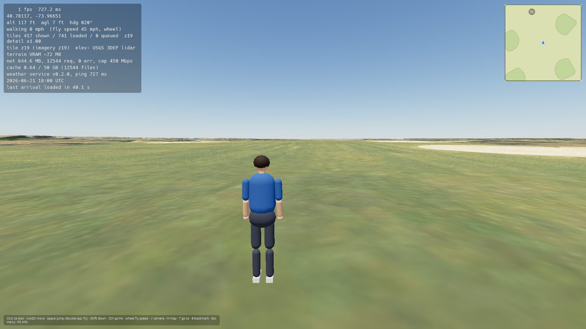
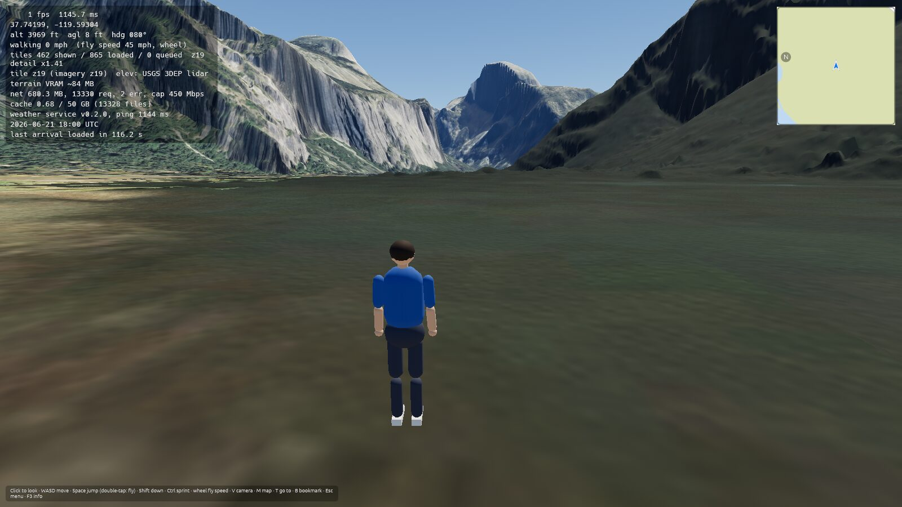
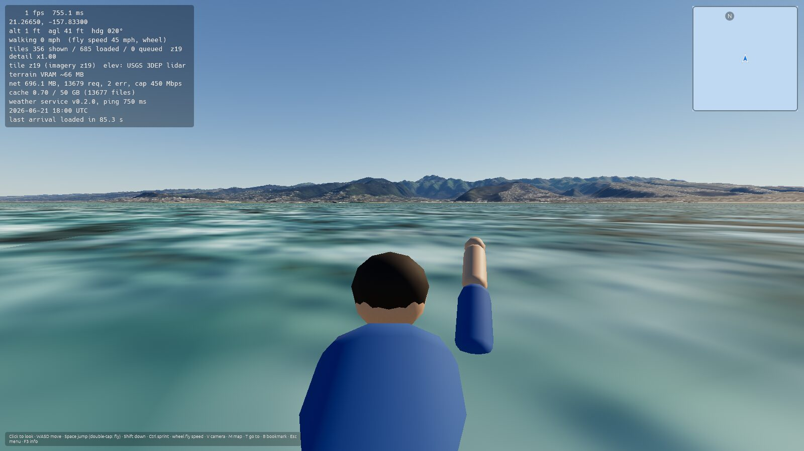
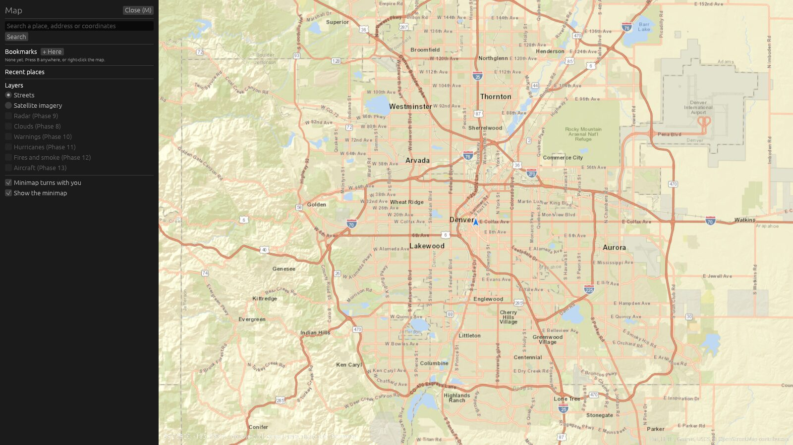

# Progress: Phase 2 (Player, cameras and maps), v0.2.0

**Status:** complete · released as v0.2.0 on 2026-10-20 · previous phase: [Phase 1](progress/progress_phase_1.md) (released [v0.1.0](https://github.com/goglesquirmintontheiii/us-explorer/releases/tag/v0.1.0))

Goal: a player you can walk, jump, swim and fly as, with three camera views, a minimap and a full map with search, teleport and bookmarks.

Open GitHub issues checked at the start of this phase: none.

## Tasks

- [x] Player body with walk, run, jump, fall, fly, hover, swim and idle animations (procedural, jointed)
- [x] Outfits: casual, rain jacket, winter, hiker (Settings → Outfit)
- [x] Camera views: first person with your body visible, third-person over the shoulder, free orbit; V (or F5) cycles them
- [x] Walking with gravity, jumping, stepping up curbs and snapping down slopes
- [x] Double-tap Space (within 300 ms) toggles flying and walking
- [x] Flight: Space rises, Shift descends, no gravity, stops when keys are released
- [x] Sprint in both modes (Ctrl); mouse wheel changes fly speed from walking pace up to 1,000 km/h
- [x] Touching the ground while flying down drops you into walk mode (Settings → Land on touch)
- [x] Swimming in the sea: float at the surface, Space swims up, Shift dives
- [x] Debug no-clip (N); collision with buildings and objects arrives with them in Phases 3–4
- [x] Bridge decks and overpasses are walkable (walkable surface index, used by Phase 3 roads)
- [x] Corner minimap that rotates with you; click it or press M to open the full map
- [x] Full map: drag and zoom out to the whole US, place and address search, double-click (or right-click → Teleport) anywhere to go there
- [x] Map layers panel (street map now; radar, clouds, warnings, hurricanes, fires, smoke and aircraft switch on in their phases)
- [x] Gamepad support (sticks, A jump/fly, B descend, Y camera, X bookmark, Select map)
- [x] Rebindable keys (Settings → Controls), saved in settings
- [x] Bookmarks with name (looked up from the location) and view direction (B or the map); recent places list
- [x] Weather service now runs from the same executable (one file to download on Windows too)
- [x] Windows: no console window; one-click self-update for the .exe
- [x] Fix: the third-person and orbit cameras pull in rather than going into cliffs
- [x] Fix: lidar flattens water to its surface; sea depths now come from the bathymetry tiles there
- [x] Screenshots from CI reviewed
- [x] v0.2.0 release with AppImage

## Screenshots

From the CI screenshot run (software rendering, so frame rates in the overlay are meaningless).

| | |
|---|---|
|  |  |
| Third person, Central Park | Orbit camera, Yosemite Valley |
|  |  |
| Swimming off Waikiki | Full map with search, bookmarks and layers |
