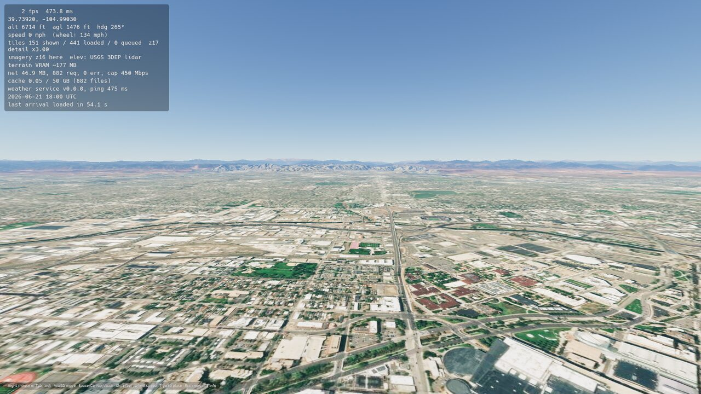
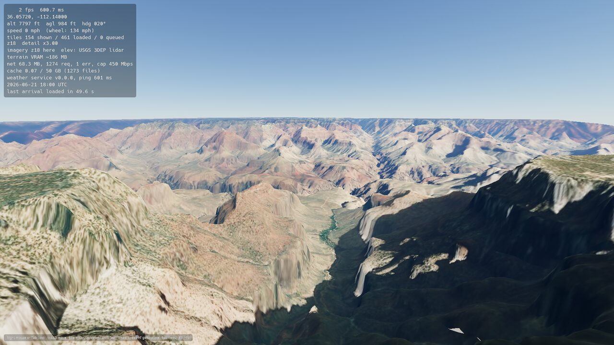
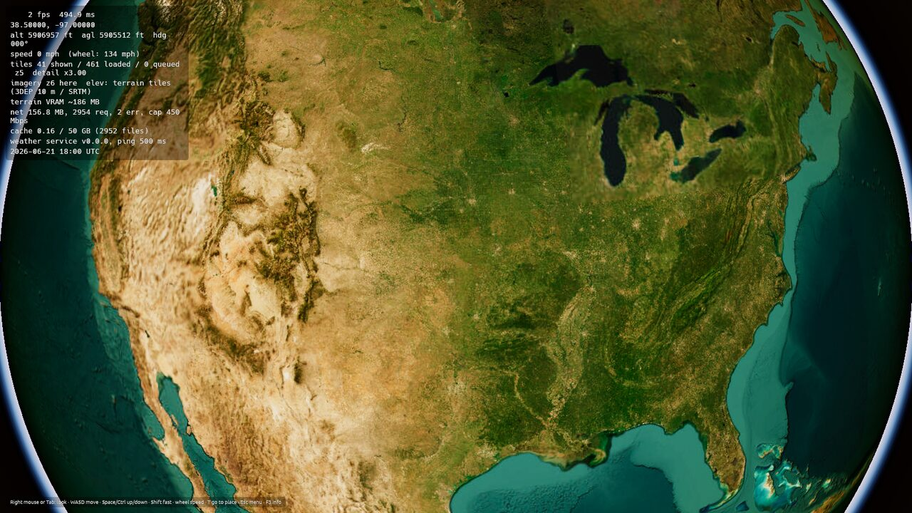
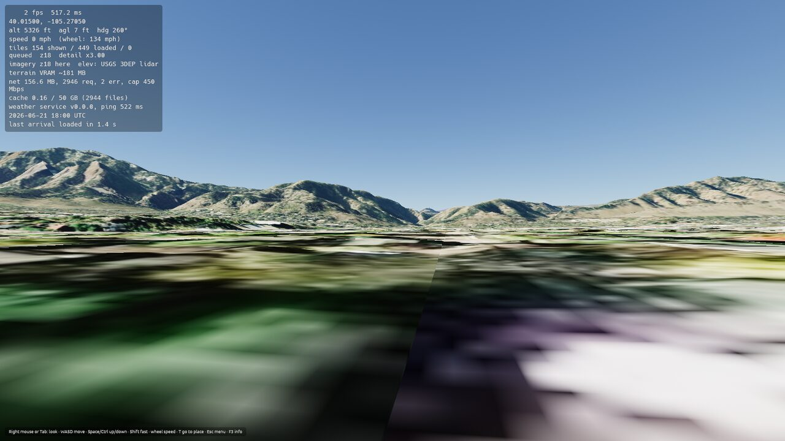
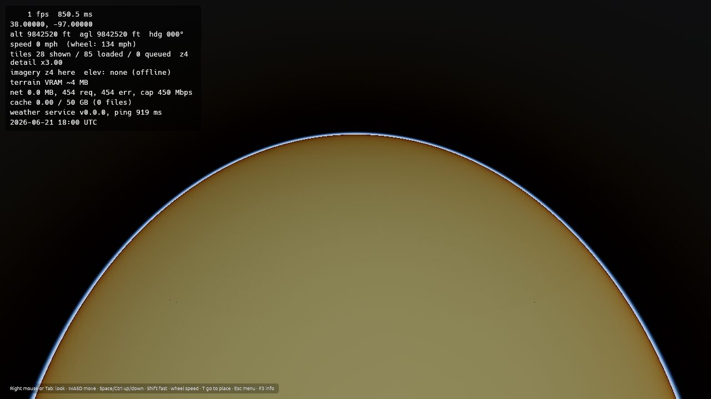

# Progress: Phase 0 (Foundations), v0.0.0

**Status:** complete · released as v0.0.0 on 2026-10-20

Goal: an empty but real globe that builds and runs on Linux (and still compiles for Windows), with the plumbing every later phase needs.

## Engine decision

The plan originally named Unreal Engine 5 + Cesium. The game is built in **Rust with Bevy 0.19.1** instead (Rust was preferred). Bevy 0.20 was released 11 days ago, so the more settled 0.19.1 is used for now. Bevy renders through wgpu, which uses Vulkan on Linux and DX12/Vulkan on Windows. Its built-in physically based atmosphere gives the sky, and egui provides the menus.

## Tasks

- [x] Cargo workspace: `usx-core` (no engine code), `usx-weather` (service), `us-explorer` (game)
- [x] WGS84 globe math (geodetic ⇄ ECEF, local frames) with unit tests
- [x] Floating origin that rebases every 2 km, so there is no jitter anywhere on Earth
- [x] Builds on Linux (Vulkan); Windows compile check in CI (no Windows builds yet)
- [x] Weather service runs as its own process and handshakes over a localhost socket
- [x] Disk cache with a size limit and least-recently-used eviction
- [x] Settings file (`~/.config/us-explorer/settings.toml`) and settings menu
- [x] Debug overlay (F3): FPS, frame time, position, tiles, VRAM estimate, network, cache, weather service
- [x] Teleport by coordinates or by place/address search (OpenStreetMap Nominatim)
- [x] Credits screen listing every data source and its attribution
- [x] Global download cap (default 500 Mbps, adjustable) shared by everything
- [x] Auto-update: checks GitHub releases, one-click download + checksum + restart
- [x] Real sun position and physically based sky
- [x] CI: tests, release build, AppImage, Windows check, screenshots
- [x] Early terrain streaming (Phase 1 preview): real elevation, lidar and imagery
- [x] Release v0.0.0 AppImage

## Screenshots

CI renders these with real data on a software renderer (about 2 fps), so the frame rate in the overlay is not representative.

**Denver, looking west at the Front Range** (USGS 3DEP lidar, Esri imagery)

**Grand Canyon from 300 m above the South Rim**

**The contiguous US from 1,800 km up**

**Street level in Boulder.** Ground detail is the weak spot; Phase 1 continues here.

**Offline fallback globe:** with no network, a plain globe still renders and retries.

## Notes

- Cold arrival took 50 s in CI because the software renderer runs at 2 fps and tiles are uploaded a few per frame. On real GPUs it should be several times faster; the overlay shows "last arrival loaded in N s" so you can check.

- Heights are metres above sea level placed on the WGS84 ellipsoid (the ~30 m geoid offset is ignored for now).
