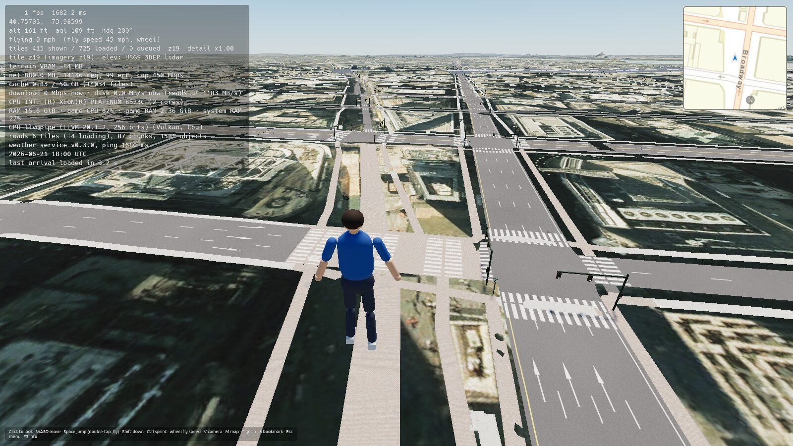
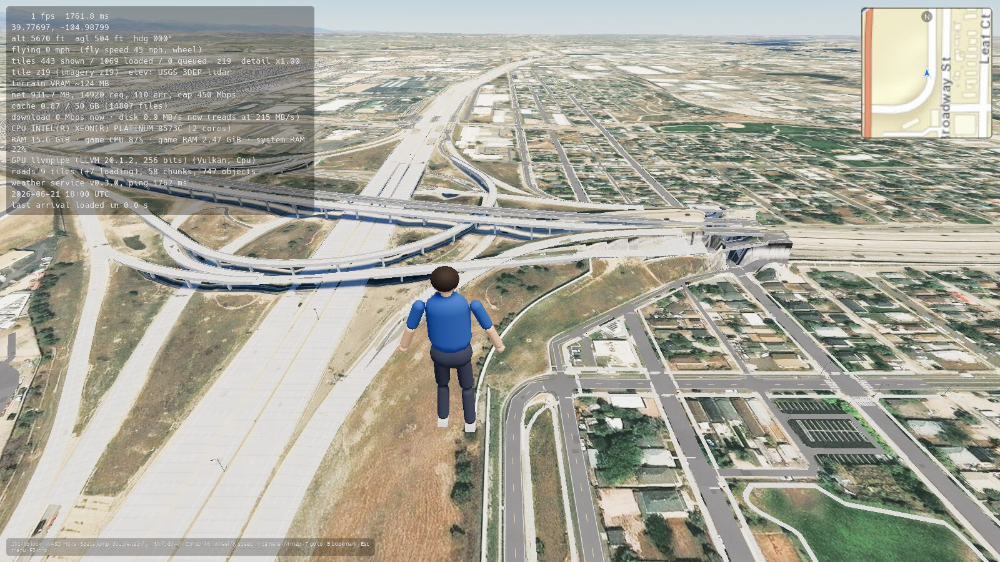
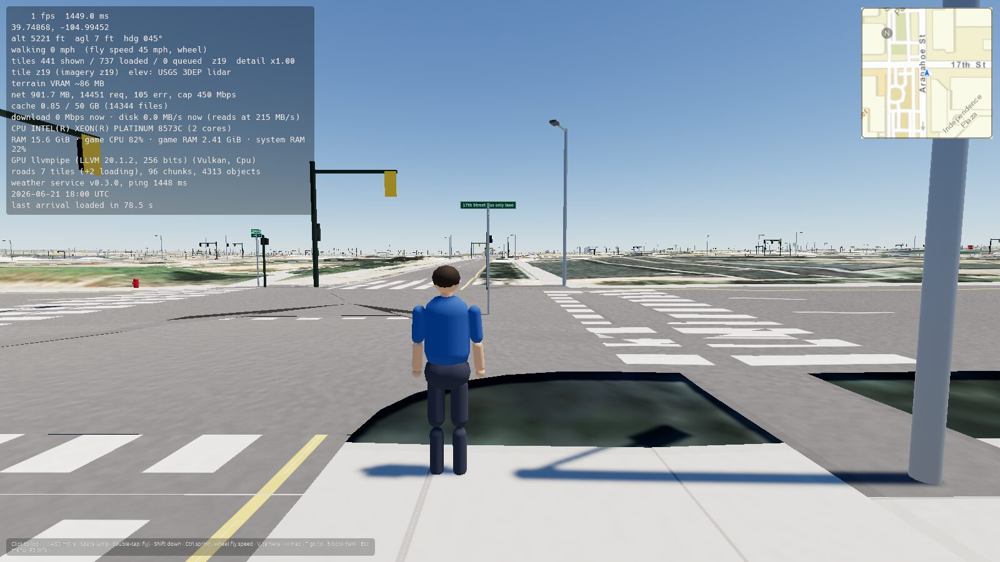
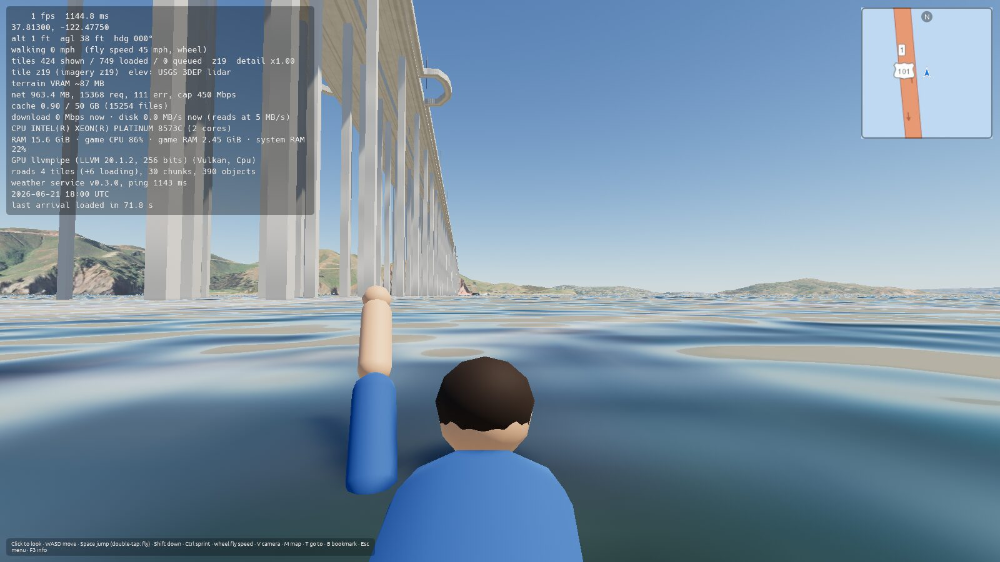
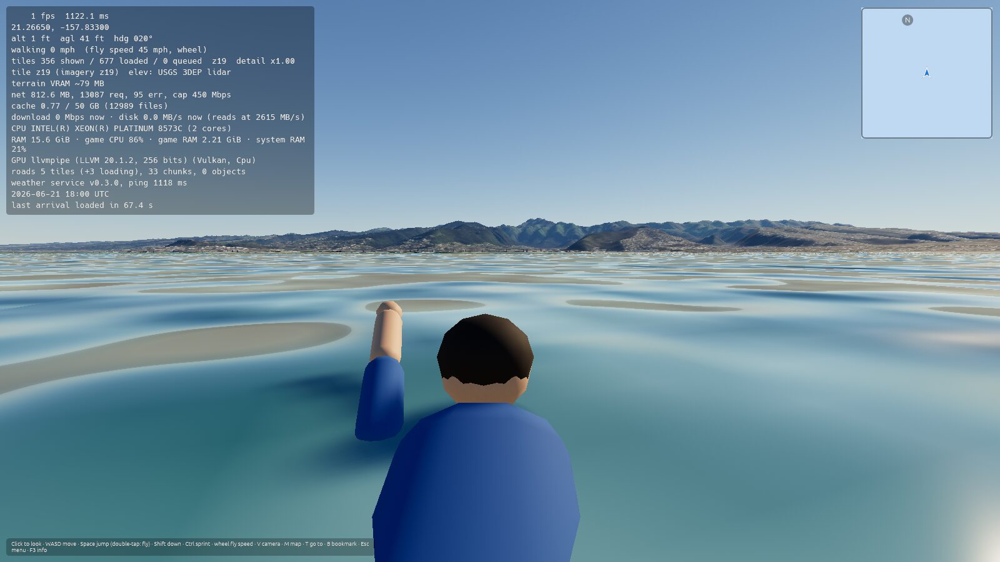
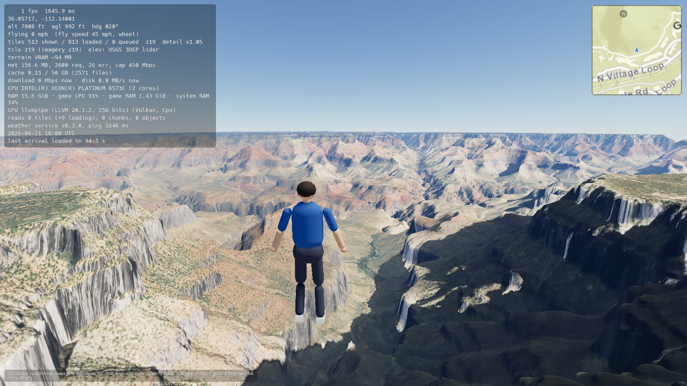

# Progress: Phase 3 (Roads, bridges and roadside objects), v0.3.0

**Status:** complete · released as v0.3.0 on 2026-10-20 · previous phase: [Phase 2](progress_phase_2.md) (released [v0.2.0](https://github.com/goglesquirmintontheiii/us-explorer/releases/tag/v0.2.0))

Goal: every road in the US drawn from OpenStreetMap, sitting properly on the terrain, with bridges, tunnels, interchanges and the things along the roadside.

Open GitHub issues checked at the start of this phase: none.

## Tasks

- [x] OSM data per ~2 km tile from Overpass (three public servers, fallback between them), cached on disk in a compact binary form (about 13x smaller than the JSON)
- [x] Road surfaces from OSM ways: width from lanes, shoulders and highway class (or the `width` tag)
- [x] Terrain levelled under every road with smoothed cut and fill, blending back to the natural slope beside it; road meshes re-drape whenever the ground under them gets more detailed
- [x] Junctions merged into one surface with curb returns; roads trimmed back to them, so nothing overlaps or flickers
- [x] Lane markings from `lanes`, `lanes:forward/backward`, `oneway` and `turn:lanes`: centre lines (double yellow / dashed), lane lines, edge lines, turn arrows; crosswalks and stop lines
- [x] Sidewalks and curbs from tags, or on urban streets where sidewalks aren't mapped separately, with corners that follow the curb returns
- [x] Bridges: decks, parapets, undersides and piers; deck heights interpolated between where they meet the ground, kept clear of the roads and railways they cross (`layer`)
- [x] Approach ramps: roads climb to overpasses and dip into underpasses at a 5% grade, with the terrain filled or cut to match
- [x] Tunnels: walls, lit ceilings, portal headwalls; the hillside opens up at the portals; walkable inside
- [x] Interchanges: ramps and viaducts grouped into networks and stacked by layer
- [x] Street name signs at intersections with the real names (USPS abbreviations); route shields for Interstate, US and state routes with real numbers; exit signs at motorway junctions
- [x] Traffic signals on mast arms with working cycles (each junction phased by approach), pedestrian signals; stop and yield signs; all from OSM, or inferred at untagged junctions
- [x] Streetlights from OSM, or spaced along urban roads; they light up at night
- [x] Guardrails from OSM, and along bridge approaches and high embankments
- [x] Cones and barrels at construction zones
- [x] ALPR camera posts where mapped
- [x] Utility poles, fire hydrants, mailboxes, bus stops (with shelters and benches when tagged), benches, bollards, speed limit signs
- [x] Potholes, patches and wear, more on roads tagged rough and on minor rural roads; potholes fill with water in rain (the same positions are available to the game for vehicles later)
- [x] Railways (ballast, sleepers, rails); surfaces from the `surface` tag: asphalt, concrete, pavers, gravel, dirt, wood, metal
- [x] Roadside objects are separate entities made of parts, ready to be knocked down in Phase 18; you collide with poles, posts and hydrants
- [x] Settings → Roads switch; draw ranges follow the graphics preset
- [x] From the v0.1.0 notes: sun shadows (terrain, bridges, objects, player), by preset, with a Settings switch
- [x] From the v0.1.0 notes: sea shading (waves, sun glint, sky reflection, depth colour, whitecaps, shore foam)
- [x] From the v0.1.0 notes: faster streaming (lidar fetched per zoom-17 block, imagery and elevation in parallel, more workers)
- [x] From the v0.1.0 notes: hardware stats in F3 (CPU, cores, RAM, GPU, usage, download and disk speeds)
- [x] Offline downloads include lidar blocks and road data
- [x] Fix: road loading timed out on dense city tiles (longer Overpass limit, requests spread over all servers)
- [x] Fix: re-draped road chunks replaced their mesh while the renderer was still using it
- [x] Fix: terrain turned black (and the sea red) because the water data was multiplied into the imagery colour
- [x] Fix: arriving at a bridge puts you on the deck instead of the ground or water under it
- [x] Fix: sidewalk corners filled out to where the sidewalks meet (a gap showed the ground behind the curb)
- [x] Screenshots from CI reviewed
- [x] v0.3.0 release with AppImage and Windows .exe

## Screenshots

From the CI screenshot run (software rendering, so frame rates in the overlay are meaningless; some shots were taken while far roads were still loading).

| | |
|---|---|
|  |  |
| Times Square: merged junctions, crosswalks, turn arrows, signals | I-25 / I-70 "Mousetrap", Denver: stacked ramps and viaducts |
|  |  |
| Downtown Denver at street level: signals, street signs, lamps, shadows | Bridge piers down to the water |
|  |  |
| The sea: waves, sky reflection, reef showing through | Sun shadows across the Grand Canyon |
