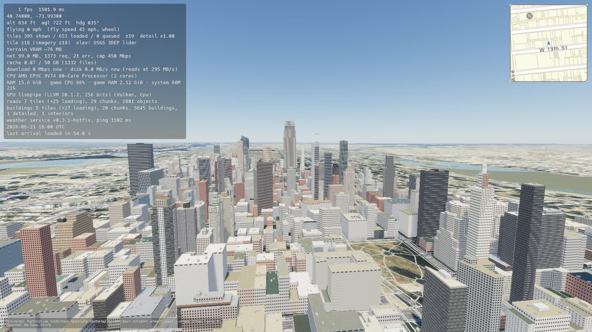
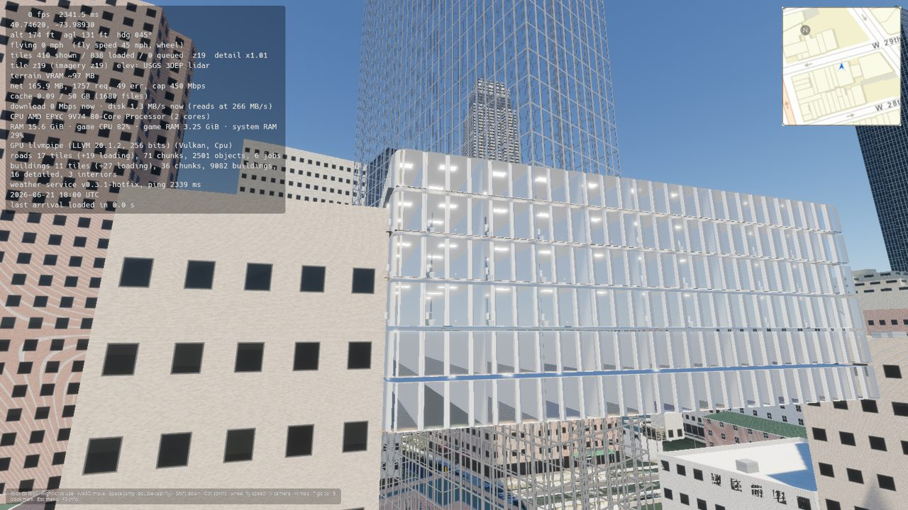
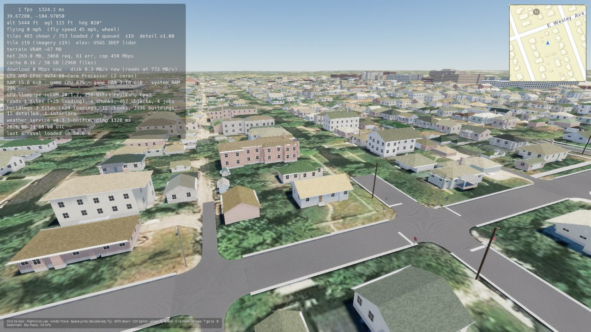
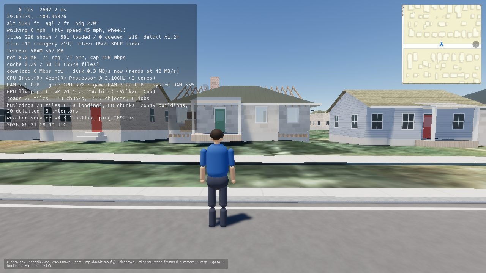
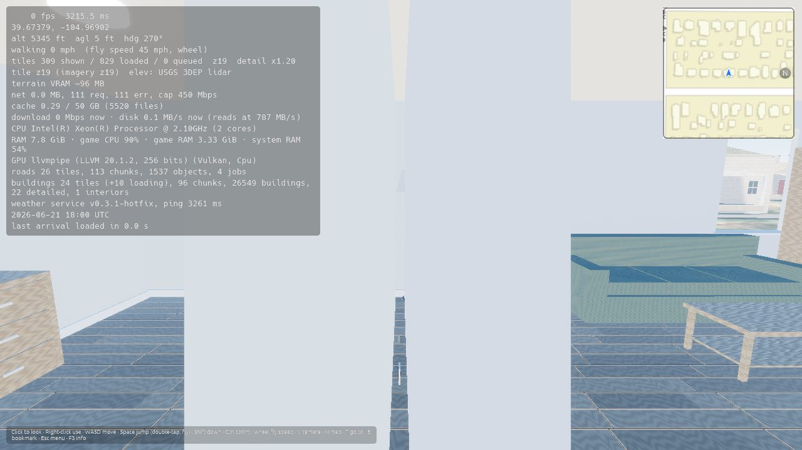
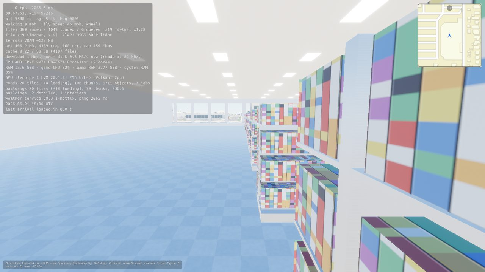
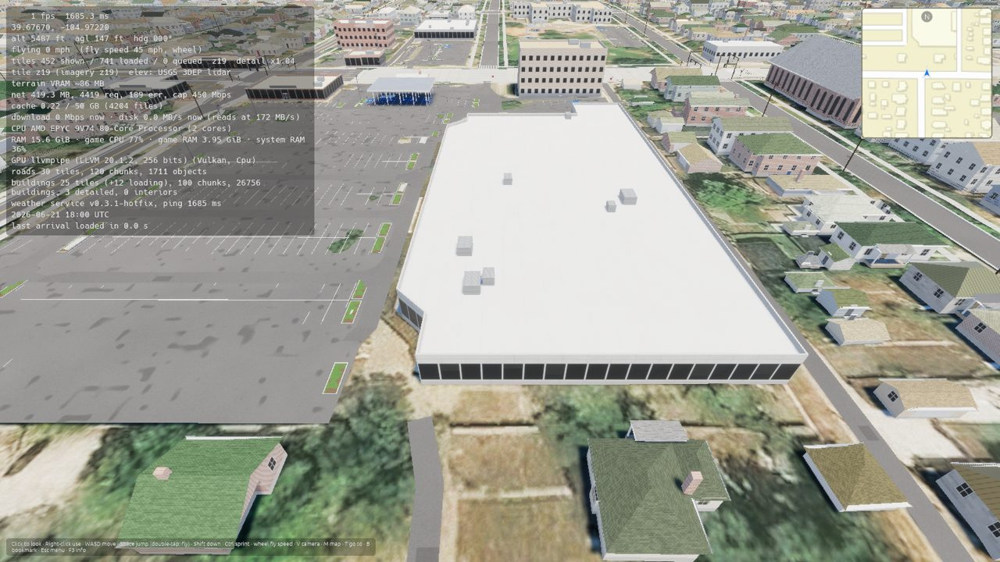
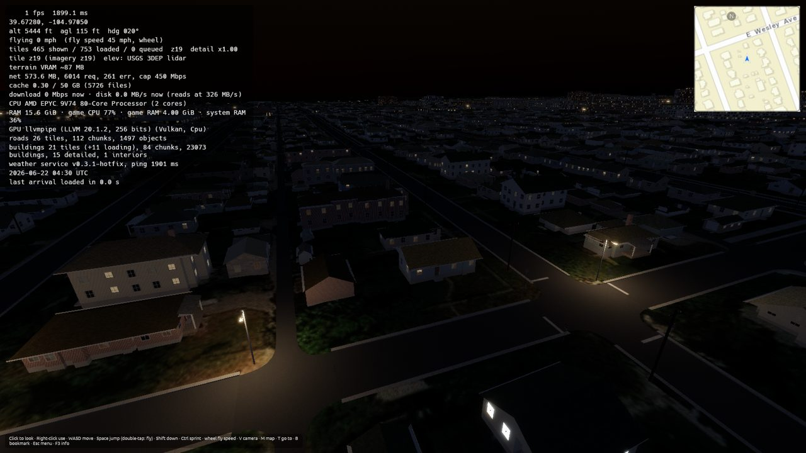

# Progress: Phase 4 (Buildings and interiors), v0.4.0

**Status:** complete · released as [v0.4.0](https://github.com/goglesquirmintontheiii/us-explorer/releases/tag/v0.4.0) on 2026-10-21 · previous phase: [Phase 3.1](progress_phase_3_1.md) (released [v0.3.1-hotfix](https://github.com/goglesquirmintontheiii/us-explorer/releases/tag/v0.3.1-hotfix))

Goal: every building in OpenStreetMap drawn in 3D with the right height, roof, materials and colours, real doors you can open, and an interior you can walk around in, furnished for what the building is. Also the fixes and requests from testing 0.3.1. Linux AppImage and Windows build.

Open GitHub issues checked at the start of this phase: none.

## Tasks

### 0.3.1 fixes and requests
- [x] Terrain no longer pokes through roads: levelling reaches a full lattice step past the road edge, neighbouring tiles' roads count, where two levelled strips overlap the lower one wins, and road surfaces get a depth bias
- [x] Roads passing under other roads: the upper road is draped from the natural ground, not the cutting dug for the lower one
- [x] Golden Gate drawn once: the bridge style is decided for the whole connected bridge, superstructure only on its outer sides
- [x] Signs, lamps and other objects that landed in a roadway step out to the road edge
- [x] Signal green is a real green; pedestrian symbols readable in daylight; far lights no longer flicker (lamp heads grow with distance)
- [x] Flock ALPR model rebuilt in more detail with a textured solar panel
- [x] Lakes are dug out below their surface so you can't swim through the bottom; water colour by region and type (blue, green, tea-brown)
- [x] Far water no longer turns to white noise (ripples fade with distance)
- [x] Ground no longer turns red high up (the atmosphere is ray-marched above 12 km)
- [x] The cursor is freed while the map is open
- [x] Title screen: Play (pick where to start: featured places, search, bookmarks, the map), Resume, Customize (character editor), Settings
- [x] GPU busy % in the F3 overlay
- [x] Minimap tiles retry instead of staying empty
- [x] Flight speed up to Mach 10

### Buildings
- [x] Buildings layer from OpenStreetMap in 1 km tiles: buildings, building parts, indoor rooms, entrances and the shops, restaurants and offices inside
- [x] Heights from `height`/`building:levels`, defaults by type and size; multi-part buildings (`building:part`) with setbacks and towers
- [x] Roof shapes (flat, gabled, hipped, half-hipped, gambrel, mansard, pyramidal, skillion, round, dome) with eaves, soffits, chimneys, parapets and rooftop units
- [x] Roof colours from `roof:colour`, else measured from the aerial imagery over the roof, else a palette by material
- [x] Facades by type and region: brick with mortar, siding, stucco, stone, concrete, glass curtain walls with inset panes, 3D shingles; windows with frames and a room behind the glass; storefronts; lit windows at night
- [x] Houses: porches, chimneys, garages with garage doors, carports; many door styles and colours
- [x] Buildings stand on the natural ground with foundations down to the terrain; the terrain is kept below their floors (and basements)
- [x] Landmark folder: a glTF named by OSM id replaces the building, placed and scaled automatically
- [x] Chunked meshes (one draw per ~600 m area), buildings split per building for later damage

### Doors and interiors
- [x] Real doors at OSM entrances, or the side facing the street; right-click to open and close; double doors open together
- [x] Interiors built when you're close and can see in through a window or an open door (or are inside), at most a few at once
- [x] Floor plans by type: houses (living, kitchen, dining, bedrooms, baths, laundry, halls, garage, attics, basements), offices (lobby, core with stairs and elevators, open offices, offices, conference, break rooms, restrooms), shops and supermarkets, restaurants by kind, schools, hospitals, hotels, churches, factories and warehouses
- [x] Mapped indoor rooms (OSM Simple Indoor Tagging) used where they exist
- [x] Stairs between floors, working elevators with call buttons and floor buttons
- [x] Furniture and fixtures: beds, sofas, tables, desks and office chairs, cubicles, printers, scanners, shelves, phones and computers, kitchens, break rooms, checkouts, gondolas, fridge cases, produce bins, booths, counters, espresso machines, machines and conveyors, pallet racks, lockers, pews, classroom desks, hospital beds
- [x] Right-click to sit (move to get up) or lie down; taps, showers, baths and toilets run and flush; fridges, freezers, ovens, microwaves, dishwashers and washers open; screens turn on
- [x] Bathroom mirrors show a real reflection (you included)
- [x] Outlets and Ethernet ports, light switches, ceiling lights that light the room; paint colours and floors by room (tile in baths and some kitchens, wood, carpet)
- [x] Attics with insulation, rafters, ducts, a furnace and water heater; unfinished basements with exposed joists, pipes and wiring

### Parking lots
- [x] Paved surface, rows of striped stalls along the mapped aisles, accessible stalls with hatched aisles and signs, planted islands and medians, wheel stops, lights

### Release
- [x] Building fixtures from six cities run through the whole pipeline in tests (no panics, interiors for nearly every building)
- [x] Quick bug sweep (see below)
- [x] v0.4.0 released (AppImage and Windows .exe); release screenshots skipped as asked, a short building-only screenshot run was used for checking

## Bug sweep

Found and fixed while checking the release:

- The building shader didn't compile (a reserved word), so buildings were invisible
- Buildings drawn in detail kept the height they were first given on coarse terrain and could float tens of metres up (or sit underground) once finer terrain arrived; they now follow the building's latest placement
- Interior lights made nearby buildings vanish on some GPUs; real lights now only light the building you're in (six nearest you), the rest glow
- Indoors everything was washed out: the sky's ambient light reached inside; it's turned down when you're indoors and exposure adapts less
- A supermarket with a pharmacy counter became a hospital: buildings now go by the most telling shop or amenity inside, and a cafe in a tower doesn't make the tower a restaurant
- Basements dug craters around houses: the ground is only kept below floors now
- Attic rafters poked through hipped roofs
- Two systems asked for the same resource twice (a crash at start)
- Screens and mirrors faced into the wall; interior walls could be invisible from one side
- Doorways had no step up from the ground; the third-person camera went through walls and ceilings
- Big office floors away from yours are no longer furnished (a third of the triangles), and are filled in as you move between floors

## Screenshots

From the CI check run and local runs (software rendering, so frame rates in the overlay are meaningless).

| | |
|---|---|
|  |  |
|  |  |
|  |  |
|  |  |
